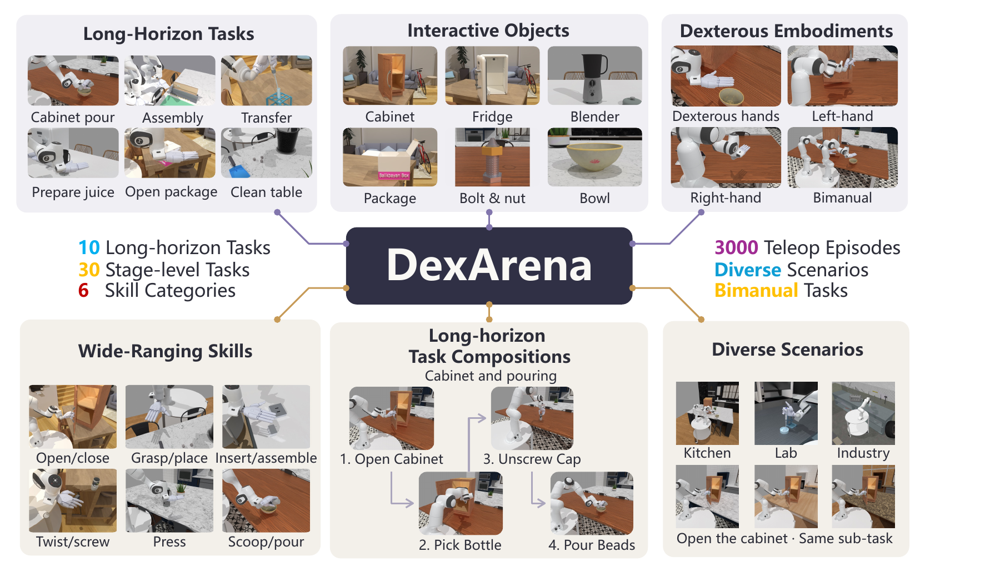

<p align="center">
  
</p>

<h1 align="center">DexArena Website</h1>

<p align="center">A unified benchmark for long-horizon bimanual dexterous manipulation.</p>

<p align="center">
  <a href="https://sipair-elastic.github.io/DexArena-website/"></a>
  <a href="https://arxiv.org/abs/2611.02629"></a>
  <a href="https://github.com/SIPAIR-Elastic/DexArena"></a>
  <a href="CONTRIBUTING.md"></a>
</p>

This repository maintains the DexArena project website: English-language pages,
interactive benchmark results, task previews and public presentation assets.

> [!NOTE]
> **Website source, not the simulator.** The [benchmark implementation](https://github.com/SIPAIR-Elastic/DexArena)
> is maintained separately. You do not need the simulator, private datasets or
> model checkpoints to build or preview this website.

## Contents

- 🌐 [Explore the benchmark](#explore-the-benchmark)
- 🚀 [Quick start](#quick-start)
- 🗂️ [Project structure](#project-structure)
- 📌 [Publication status](#publication-status)
- ☁️ [GitHub Pages deployment](#github-pages-deployment)
- 📊 [Results and media](#results-and-media)
- 📝 [Citation and feedback](#citation-and-feedback)

## Explore the benchmark

DexArena connects **10 long-horizon tasks**, **30 stage-level tasks** and
**3,000 replay-validated demonstrations**. The website presents six baseline
methods across stage execution, cross-scene generalization and complete-task
composition.

<p align="center">
  <a href="dist/assets/paper/dexarena-overview.png"></a>
</p>

<p align="center"><em>DexArena at a glance: tasks, objects, embodiments and demonstrations.<br>Select the figure to view it at full resolution.</em></p>

| Page | What you can find |
| --- | --- |
| 🌐 [Project](https://sipair-elastic.github.io/DexArena-website/) | Research overview, authors, affiliations, figures and task previews |
| 🧩 [Tasks](https://sipair-elastic.github.io/DexArena-website/tasks/) | Ten task sequences, stage definitions and physical success conditions |
| 📊 [Leaderboard](https://sipair-elastic.github.io/DexArena-website/leaderboard/) | Charts, searchable heatmaps, exact tables, method profiles and downloads |
| 🧪 [Evaluation](https://sipair-elastic.github.io/DexArena-website/evaluation/) | Evaluation tracks, metrics and reproducibility requirements |
| 📰 [Report](https://sipair-elastic.github.io/DexArena-website/report/) | Research updates, sourced coverage and conference information |
| 💻 [Code](https://sipair-elastic.github.io/DexArena-website/code/) | Official benchmark repository and issue tracker |

## Quick start

### 1. Check the prerequisites

Use **Git** and **Node.js 22 or later**, with npm available.

> [!TIP]
> **No dependency installation is required.** The website uses Node.js built-ins
> and browser-native HTML, CSS and JavaScript.

### 2. Clone the development branch and start the preview

```bash
git clone --branch DexArena_V1 https://github.com/SIPAIR-Elastic/DexArena-website.git
cd DexArena-website
npm start
```

Open **http://localhost:4173/DexArena-website/**.

The preview rebuilds once at startup and runs on your computer only. It is not a
public deployment and does not watch for changes. After editing source files,
run `npm run build` in another terminal and refresh the browser, or restart the
preview.

### 3. Build and verify your changes

```bash
npm run build
npm test
```

Build before testing so the generated pages match the source. The checks cover
publication visibility, links, navigation, accessibility-related contracts,
typography, media integrity and all 420 reported task/method results.

<details>
<summary>🛠️ Need another local port?</summary>

If port 4173 is occupied, use another port:

```bash
PORT=4200 npm start
```

Open `http://localhost:4200/DexArena-website/` in that case. The port example uses
a Bash-compatible shell.

</details>

## Project structure

| Location | Responsibility |
| --- | --- |
| [`src/build.mjs`](src/build.mjs) | Shared page shell, task catalog and page generation |
| [`src/paper-page.mjs`](src/paper-page.mjs) | Homepage research overview, author information and citation |
| [`src/leaderboard.mjs`](src/leaderboard.mjs) | Result visualizations and tables; companion CSS/JS handle layout and interactions |
| [`src/report.mjs`](src/report.mjs) | Report content, backed by [`report-sources.json`](src/report-sources.json) |
| [`src/readability.css`](src/readability.css) | Final shared typography layer: 18px body text, 17px on narrow screens, 16px controls and a 14px metadata floor |
| [`src/publication.mjs`](src/publication.mjs) | Paper/code URLs, documentation visibility and retired-route rules |
| [`dist/`](dist/) | Published pages **and retained media, fonts and result downloads** |
| [`scripts/`](scripts/) | Build, preview, tests and specialist research-asset utilities |
| [`.github/workflows/pages.yml`](.github/workflows/pages.yml) | Production build, verification and GitHub Pages deployment |

> [!WARNING]
> **Do not delete `dist/` before building.** Some committed images, videos, fonts
> and result exports live there and cannot be recreated by the normal website
> build. Edit page content in `src/`, rebuild, then include the resulting
> tracked output in your PR. See the [editing guide](CONTRIBUTING.md#what-to-edit).

## Publication status

- 📄 **Paper:** public [arXiv preprint](https://arxiv.org/abs/2611.02629). Paper actions open arXiv; `/paper/` is a compatibility redirect.
- 💻 **Code:** links to the [official benchmark repository](https://github.com/SIPAIR-Elastic/DexArena), separate from this website repository.
- 📚 **Docs:** temporarily hidden from navigation, search and sitemap. Source articles remain available for maintenance; old URLs show a no-index preparation notice.
- 📊 **Results:** fixed manuscript baselines, not a live community-submission ranking. Submission intake is not open.

The publication switches are in [`src/publication.mjs`](src/publication.mjs).
Restore hidden content only through an explicitly reviewed release change.

## GitHub Pages deployment

Production: **https://sipair-elastic.github.io/DexArena-website/**

> [!IMPORTANT]
> **`DexArena_V1` → pull request → `main`** is the website update workflow.
> Do not push directly to `main` or merge without maintainer approval. The
> [contributor guide](CONTRIBUTING.md#branch-and-pull-request-workflow) includes
> commands and the review checklist.

After an approved merge, the [Pages workflow](.github/workflows/pages.yml)
automatically builds, tests and publishes `dist/`. A push to `DexArena_V1` or
opening a PR does **not** publish the production site. The current workflow
does not run on PR events, so run the checks locally before requesting review.

<details>
<summary>⚙️ First-time Pages setup and repository paths</summary>

For the initial repository setup, select **Settings → Pages → Source → GitHub
Actions**. The existing workflow uses the GitHub Pages environment and a
short-lived Actions token; no third-party hosting account or deployment secret
is required. Authorized maintainers can also run the workflow manually.

The build derives the production hostname and project path from
`GITHUB_REPOSITORY`. Local builds default to `SIPAIR-Elastic/DexArena-website`.
Repository transfers, base-path configuration and cached-page troubleshooting
are covered in the [maintenance notes](CONTRIBUTING.md#deployment-and-publication).

</details>

## Results and media

The leaderboard preserves **420 task-level measurements** across six methods
and three tracks. Its default chart scale is 0–100%; a separately labeled 0–2%
detail view is available for long-horizon averages. Cross-scene `±` values are
**standard deviations across scenes**, not confidence intervals.

Download [result JSON](https://sipair-elastic.github.io/DexArena-website/assets/results/paper-results.json)
or the [snapshot manifest](https://sipair-elastic.github.io/DexArena-website/assets/results/release.json).
CSV downloads and shareable filtered views are available on the
[leaderboard](https://sipair-elastic.github.io/DexArena-website/leaderboard/).
See [result maintenance](CONTRIBUTING.md#results-and-provenance) before changing
scientific data or source attribution.

Homepage task cards default to images. You can also
[open the video variant](https://sipair-elastic.github.io/DexArena-website/?task-media=videos#simulation-tasks).
These are representative human-teleoperated **stage demonstrations**, not
complete-sequence policy rollouts or evidence for the baseline scores. Ten
presentation-only scene styles do not change the three-scene evaluation setup.
Committed previews work without private research recordings; re-rendering them
is an [optional specialist workflow](CONTRIBUTING.md#optional-research-media-workflow).

## Citation and feedback

For scientific use, cite **DexArena: A Unified Benchmark for Long-Horizon
Dexterous Manipulation**, [arXiv:2611.02629](https://arxiv.org/abs/2611.02629).
Use the [BibTeX reference](dist/assets/docs/dexarena-citation.bib) or copy it from
the website's leaderboard release section.

- 🐛 Website bugs or suggestions: [website issues](https://github.com/SIPAIR-Elastic/DexArena-website/issues).
- 💬 Benchmark implementation questions: [benchmark issues](https://github.com/SIPAIR-Elastic/DexArena/issues).
- 🤝 Website contributions: follow [CONTRIBUTING.md](CONTRIBUTING.md).

For a display issue, include the page URL, browser, viewport size and a screenshot.
Media and institutional-mark sources are recorded in
[`src/asset-provenance.json`](src/asset-provenance.json); bundled fonts retain
their license files in [`dist/assets/fonts/`](dist/assets/fonts/).
